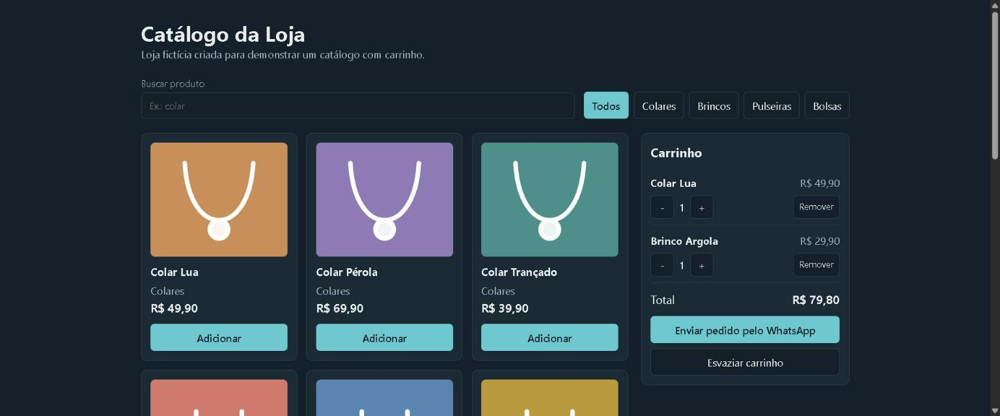

# Catálogo da Loja

Catálogo de produtos com busca, filtros, carrinho e envio do pedido pelo WhatsApp.

**[Abrir o projeto](https://beasil07.github.io/catalogo-loja/)**



## Problema

Lojas pequenas costumam receber pedidos soltos por mensagem, com produtos e valores incompletos. O catálogo permite que o cliente monte o pedido e envie uma mensagem já organizada, com itens, quantidades e total.

## Funcionalidades

- Lista com 12 produtos fictícios.
- Busca pelo nome e filtro por categoria.
- Inclusão e remoção de produtos no carrinho.
- Alteração de quantidades e cálculo do total.
- Carrinho salvo ao recarregar a página.
- Pedido gerado em um link do WhatsApp.

## Decisões do projeto

- **Regras separadas da tela:** o carrinho fica em `src/carrinho.js`, o que permite testar os cálculos sem abrir o navegador.
- **Preços em centavos:** os valores são inteiros para evitar erros de arredondamento.
- **Validação do carrinho salvo:** dados inválidos no navegador são ignorados.
- **Imagens em SVG:** as ilustrações foram criadas no próprio projeto, sem depender de imagens externas.
- **Publicação automática:** a cada envio para a branch `main`, o GitHub Actions roda os testes, gera o site e publica no GitHub Pages.

## Tecnologias

React, Vite, JavaScript, CSS, localStorage e GitHub Actions.

## Como rodar

```bash
npm install
npm run dev
```

## Testes

```bash
npm test
```

O número de WhatsApp é fictício e fica na constante `NUMERO_WHATSAPP`, em `src/carrinho.js`. A loja, os produtos e os preços também são fictícios.
